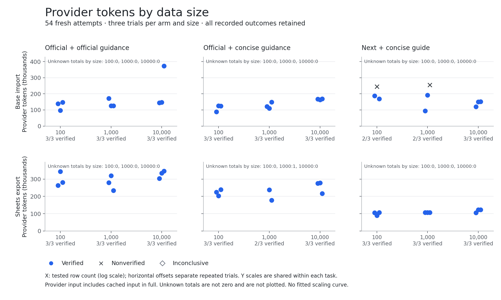

# Provisional evaluation assessment

The measurements show task-specific gains and substantial regressions. They do
not establish a general token-efficiency advantage or release readiness. The
implementation retains the full reference capability target; sampling successful
agent tasks does not replace capability reconciliation, section correctness or
live verification. [Release requirements and outstanding gates](../docs/IMPLEMENTATION.md)
remain authoritative.

## Native fidelity amendment — 2026-09-08

The [independent validity audit](evidence/native-fidelity-validity-audit-20260908.md)
qualifies the historical Docs, Sheets and Base results below. Private native tests
contradicted Docs plain-replacement style inheritance, Sheets render-mode fidelity
and Base create-time empty-text preservation assumed by the development fixtures.
Withhold same-fidelity efficiency conclusions for Docs, Sheets and Base size tasks.
Small Base uses update rather than create; its empty-text fidelity remains
unvalidated, since native update normalization was not tested. These observations
do not identify which individual historical Docs trials would fail live.

All recorded costs, verdicts and plots remain historical synthetic observations.
“Verified” in the tables means the original fixture verifier, not live fidelity.
The new Sheets/Base correctness changes and Docs guidance are outside the frozen
product condition and have no new provider-token measurements.

## Historical frozen product

The following completed development tasks use candidate `8d92e52` and the guide
including `43bdff2`. Each has three fresh trials per arm with all nine outcomes
accepted by its historical synthetic verifier. The official and concise-official
arms use the same reference binary
within each task. Values are provider tokens spent across all attempts divided
by verified successes, including cached input in full. The evaluator/fixture
conditions differ between reports; these rows are not pooled into an overall
score. Ranges, matched-success pairs, latency and API counts remain in the linked
reports.

| Task | Official | Concise official | Next | Interpretation within this task |
| --- | ---: | ---: | ---: | --- |
| [Calendar](evidence/read-8d92e5/REPORT.md) | 153,198.67 | 146,588.67 | 98,273.33 | Lower than both baselines |
| [Mail](evidence/read-8d92e5/REPORT.md) | 258,457.00 | 116,976.33 | 68,579.00 | Lower than both baselines |
| [OKR](evidence/read-8d92e5/REPORT.md) | 169,457.00 | 120,259.00 | 84,193.67 | Lower than both baselines |
| [Base](evidence/scenarios-8d-schema02/REPORT.md) | 89,044.67 | 93,971.67 | 126,085.67 | Higher synthetic cost; empty-text update fidelity unvalidated |
| [Drive](evidence/scenarios-8d-schema02/REPORT.md) | 160,570.33 | 141,622.00 | 66,597.67 | Lower than both baselines |
| [Markdown](evidence/scenarios-8d-schema02/REPORT.md) | 252,573.67 | 161,417.33 | 182,177.00 | Lower than official; higher than concise |
| [Sheets](evidence/scenarios-8d-schema02/REPORT.md) | 238,373.00 | 196,719.33 | 78,226.00 | Lower synthetic cost; same-fidelity conclusion withheld |
| [Tasks](evidence/scenarios-8d-schema02/REPORT.md) | 272,985.33 | 185,645.33 | 123,521.00 | Lower than both baselines |
| [Docs, corrected fixture](evidence/scenarios-8d-corrected03/REPORT.md) | 161,107.00 | 76,104.33 | 206,796.33 | Higher synthetic cost; same-fidelity conclusion withheld |
| [Extensions, corrected observer](evidence/scenarios-8d-corrected03/REPORT.md) | 199,107.33 | 305,044.00 | 94,401.67 | Lower than both in this synthetic host task |
| [Packaging, corrected path verification](evidence/scenarios-8d-corrected03/REPORT.md) | 58,075.33 | 73,169.00 | 60,292.00 | Slightly higher than official; lower than concise |
| [Generated approval workflow](evidence/business-8d-archive03/REPORT.md) | 196,014.67 | 182,855.33 | 120,166.00 | Lower than both baselines |
| [Generated Mindnote edit](evidence/business-8d-archive03/REPORT.md) | 158,449.67 | 150,169.33 | 106,273.33 | Lower than both baselines |

Events remains separate: its three official outcomes lack sufficient execution
proof and are inconclusive. Its verified concise/Next results do not establish a
complete three-arm comparison. Earlier Docs, Extensions and Packaging attempts
also retain their original costs and inconclusive interpretations. The
[81-attempt report](evidence/scenarios-8d-schema02/REPORT.md) records these limits;
corrected balanced trials do not retroactively turn discarded outcomes into
successes.

## What the observed workflows support

The current Docs regression accompanies additional discovery, help, skill reads
and local processing. Next and concise official guidance each made 24 total API
requests, so their request totals do not explain the token difference. The
[bounded trace review](evidence/scenarios-8d-corrected03/docs-trace.md) preserves
this distinction. The [Base trace review](evidence/scenarios-8d-schema02/base-trace.md)
also records additional discovery and different read/artifact choices. Neither
trace assigns provider tokens to individual commands or establishes that every
extra step was unnecessary.

The results justify retaining convenient direct operations, optional discovery,
full detail and raw/file composition. They do not justify requiring one command
sequence, hiding less common capabilities or prescribing a help/readback routine.
Raw API composition passed the corrected synthetic Docs verifier; retained traces
do not establish which native mutation or rich-text payload it used.
No product or guide tuning was applied during the frozen comparison series.

The [10,000-row cross-section process test](../docs/integration/sheets-base.md)
separately verifies preservation of 80,000 cells through actual export/import
commands. It supports the earlier artifact handoff under its controlled
assumptions; the
empty-text and formula assumptions now require the native-fidelity qualifications
above. Updated correctness checks use a separate condition.
It does not measure agent tokens as data grows. The small Sheets task above and
bounded CLI output sizes cannot substitute for provider-token measurements.

## Historical size comparison

The [fresh size comparison](evidence/scaling-8d-archive04/REPORT.md) completed
54 attempts under evaluator `4b3abc6`: 51 verified, two Base attempts nonverified,
and one Sheets timeout with unknown total usage. The 9,780,669 recorded provider
tokens are a lower bound, including 499,819 tokens from the nonverified Base
attempts. Each cell below is all-attempt tokens per verified success; parentheses
give verified attempts out of three. Unknown total usage prevents a finite score.

| Task and rows | Official | Concise official | Next |
| --- | ---: | ---: | ---: |
| Base, 100 | 127,404.33 (3/3) | 112,461.33 (3/3) | 300,151.50 (2/3) |
| Base, 1,000 | 140,715.33 (3/3) | 126,638.00 (3/3) | 271,262.00 (2/3) |
| Base, 10,000 | 221,430.33 (3/3) | 166,207.33 (3/3) | 140,433.33 (3/3) |
| Sheets, 100 | 295,636.33 (3/3) | 222,044.33 (3/3) | 100,604.67 (3/3) |
| Sheets, 1,000 | 277,664.67 (3/3) | Unknown (2/3) | 106,845.00 (3/3) |
| Sheets, 10,000 | 328,489.33 (3/3) | 256,691.00 (3/3) | 117,159.00 (3/3) |

These are costs under the original synthetic verifier, whose Base empty-text and
Sheets rendering assumptions conflict with native behavior. They cannot establish
live cost per preserved outcome or measure the new paired-read exporter.

Next's synthetic Base cost improves against both baselines at 10,000 rows but regresses
at the smaller tested sizes. Its Sheets tokens are lower in all complete
comparisons, while its 10,000-row API count is higher: 51 across three attempts,
against official 9 and concise official 13. Lower tokens therefore do not imply
fewer API requests. The two Base failures record `request_outside_fixture`
without the exact rejected payload, preventing a precise causal attribution.
The Sheets timeout retains its declared 180-second limit and unknown usage;
it was not replayed. Three tested sizes and three repeats support these
descriptive observations, not a uniform scaling or asymptotic claim.

## Earlier product conditions remain separate

| Condition | Evidence and limitation |
| --- | --- |
| [Foundation, candidate reported `d873c0d`](evidence/foundation/REPORT.md) | 18/18 verified across two tasks. Document discovery improved against both arms; unconfigured status was slightly worse than concise official guidance. The reference binary reports imported source `0c1ac75`; exact hashes are retained. |
| [Contact, `4ce36da`](evidence/contact/REPORT.md) | 9/9 verified, with Next worse than both arms. Subsequent discovery changes have no measured improvement claim on this task. |
| [Nine sections, `312af93`](evidence/read-312af93/REPORT.md) | 75/81 verified. Of eight fully successful sections, Next beat official guidance in seven but concise guidance only in IM; Application regressed against both. Six failed Wiki attempts and their costs remain. Later shared runtime changes prevent treating these as a final-product retest. |
| [Corrected Wiki, `74b6b53`](evidence/wiki-native-74/REPORT.md) | 9/9 verified with lower Next tokens than both arms after a source-backed fixture correction. It uses the earlier guide and remains separate from the older failed series and later product conditions. |

Language, domain-specific guidance and reference bundles vary between arms.
Application and Extensions have explicitly documented source-matched guidance
fallbacks where the reference has no matching skill. Meeting-related compatibility
entries load different reference bundles. The concise-official comparison helps
identify guidance-related differences but does not isolate a pure interface-only
effect in every domain. No language-specific claim follows.

## Costs, uncertainty and remaining evidence

All-attempt costs remain in their original reports, including unsuccessful,
inconclusive and interrupted attempts. The [first size condition](evidence/scaling-8d-schema02/REPORT.md)
retains 1,258,267 complete provider tokens across seven unbalanced attempts. The
[later archive-preparation probe](evidence/scaling-8d-fixture03/REPORT.md) retains
237,389 known tokens and one unknown-cost attempt. The latter total is only a
lower bound. Canceled slots that never launched a model are distinguished from
failed attempts. These interrupted series support no size curve.

Three repeats on fixed synthetic fixtures give descriptive comparisons, not a
population estimate or statistical significance claim. Sanitized traces omit
request arguments, content and per-command token attribution. Retry counters
are unavailable in several conditions. Concurrent correctness work limits some
latency comparisons. Unknown accounting prevents a finite efficiency score;
early failure is not evidence of efficiency.

The [representative business comparison](evidence/business-8d-archive03/REPORT.md)
completed all 18 attempts with verified outcomes and complete accounting under
evaluator `4b3abc6`: 2,741,785 provider tokens. Next also made fewer API requests
on both tasks: approval 24 versus official 50 and concise official 42; Mindnote
18 versus 39 and 35. These two synthetic workflows support the measured
comparisons, not acceptance of every generated business operation. The
[business trace review](evidence/business-8d-archive03/trace-notes.md) records
readback after an uncertain Mindnote mutation rather than blind write replay,
alongside discovery and schema choices. Route-level request traces and
per-command token attribution are unavailable. Held-out evaluation remains
reserved for the final release gate, with independently replaced examples for the
previously disclosed limited exposure. No live backend claims or complete
capability acceptance follow from these development measurements.

The requested `search:bot` grant and selected Contact current-account read suite
passed. Separate bot tenant verification still lacks the unrequested
`tenant:tenant:readonly` app scope. Bounded private Drive and explicit rich-XML Docs
lifecycles passed; remaining private scenarios, release-channel
and lifecycle checks, complete section acceptance and final held-out evidence
remain outstanding.
Windows behavior/reference capture remains unverified and is deferred by the
user's 2026-09-08 instruction. The provisional result is useful measured improvements on specific workflows,
with explicit regressions and unresolved release gates; there is no pooled
percentage target or current full-product performance claim.
